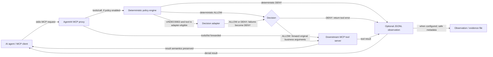

# Agent44 - A Decision Layer for AI Agent Tool Calls

[](https://www.npmjs.com/package/@imrohit44/agent44-ts-client)

Agent44 is an engineering experiment in enforcing policy at the MCP tool-call
boundary. AI agents can invoke tools, but deciding whether a call may execute
also requires policy enforcement, provenance awareness, and measurable decision
quality. Agent44 places a stdio proxy between an MCP client and a downstream
tool server, applies configured rules before forwarding calls, and can record
redaction-safe evidence about the decision and outcome.

The project explores deterministic policy first, with optional model-based
decisions only for explicitly configured unresolved calls. It does not claim
that a policy decision layer prevents every attack or secures an entire agent
application.

## Repository layout

```text
.
├── README.md             Project overview, quickstart, evaluation, and status
├── CONTRIBUTING.md       Contribution workflow
├── LICENSE              Apache-2.0 project license
├── pyproject.toml        Python package, test, and lint configuration
├── .gitignore            Generated files and local dependencies
├── src/agent44/          Python package: proxy, policy, provenance, evaluation
├── tests/                Python unit and integration tests plus test servers
├── examples/             Standalone MCP demo server and policy
├── evaluation/           Frozen protocols, policies, reports, and run results
│   ├── phase10_runs/     Preserved Phase 10 JSON results
│   └── reports/          Additional evaluation output
├── docs/                 Architecture, policy, provenance, and developer guides
├── scripts/              Benchmark source fragments, demos, and maintenance tools
├── typescript/           Independent TypeScript client package
│   ├── client/
│   └── demo/
└── www/                  Separate React/Vite website project
```

The evaluation corpus implementation lives in `src/agent44/corpus.py`; the
`evaluation/` directory contains evaluation policies, protocols, and artifacts.
Each JavaScript project has its own manifest and lockfile. Installed
`node_modules/` directories are local generated dependencies and are not part
of the source tree.

## Problem and motivation

Agent44 explores five engineering problems:

- **Policy before execution:** evaluate an MCP `tools/call` request before it
  reaches the downstream server.
- **Deterministic precedence:** make conflicts between hard denials, authority
  checks, provenance restrictions, argument rules, allow/deny lists, adapters,
  and defaults explicit.
- **Provenance propagation and validation:** represent the origin and trust
  class of values, retain lineage through derivation, and avoid treating
  caller-supplied claims as trusted.
- **Optional model-based decisions:** allow an adapter to decide only when
  deterministic rules leave a configured tool unresolved; treat adapter output
  as untrusted and fail closed on errors.
- **Measurable tradeoffs:** compare rule-only and adapter-backed decisions on
  a synthetic corpus, including incorrect allows and denials.

## Architecture

The proxy starts a downstream MCP server as a subprocess and forwards tool
discovery and calls over stdio. Policy enforcement is optional: without a
policy it forwards calls without policy enforcement; with a policy, calls are
decided before forwarding. The adapter is consulted only for an unresolved
tool explicitly listed in `adapter_tools`. Observation is separately optional
and records both denials and completed calls when enabled.



See [Architecture](docs/architecture.md) for request flow and trust
boundaries, [Policy Engine](docs/policy-engine.md) for decision precedence,
and [Provenance](docs/provenance.md) for the actual provenance integration
status.

## Features

- **Transparent MCP stdio proxy:** proxies downstream tool discovery and
  results; with a policy configured, evaluates calls before forwarding.
- **Deterministic policy engine:** strictly validates versioned YAML policies
  and uses typed `ALLOW`, `DENY`, and internal unresolved states. The enforced
  decision path resolves unresolved calls before forwarding.
- **Policy precedence and hard deny:** hard-deny tool lists and hard DENY
  argument rules cannot be overturned by a lower tier or adapter.
- **Provenance model:** Python classes represent trust classes, derived
  lineage, and explicit validation transitions. The proxy forwards a
  dictionary-valued MCP `_meta.provenanceReference` as metadata, but does not
  validate it or use it as policy evidence; see
  [Provenance](docs/provenance.md).
- **Optional decision adapters:** adapters are restricted to `adapter_tools`.
  The repository includes deterministic/replay and model/provider adapter
  components; remote backend availability is not verified.
- **Evaluation runner and synthetic corpus:** the runner replays scenarios and
  reports decision outcomes, per-category results, and adapter outcomes. Its
  measurements are scoped to individual synthetic tool-call scenarios.
- **TypeScript client component:** the published `0.2.0` adds a
  real stdio MCP client flow and passes a local integration test through the
  Python proxy. Version `0.2.0` is published on
  [npm](https://www.npmjs.com/package/@imrohit44/agent44-ts-client); install
  it with `npm install @imrohit44/agent44-ts-client@0.2.0`. See
  [TypeScript Client](docs/typescript-client.md) and the
  [v0.2.0 GitHub release](https://github.com/imrohit44/Agent44/releases/tag/v0.2.0).

## Quickstart

### Prerequisites

- Python `>=3.11,<3.14` (from `pyproject.toml`)
- [uv](https://docs.astral.sh/uv/) recommended; `pip` can also install the
  project

### Install

From the repository root:

```powershell
uv sync
```

This installs the project and its development dependency group into uv's
project environment.

### Configure a policy

Policies are YAML files loaded at proxy startup with `--policy PATH`. This
example uses fields supported by the current policy schema:

```yaml
version: "1"
name: quickstart
default_deny: true
allow_tools:
  - add
  - echo
deny_tools:
  - rm_rf
rules:
  - id: deny-echo-eval
    tool: echo
    action: DENY
    reason: "echo calls with an eval field are denied"
    when:
      field: eval
      field_exists: true
```

`default_deny: true` denies calls that no earlier policy tier authorizes.
Explicit denials and hard denials take precedence over allows. See the complete
[policy guide](docs/policy-engine.md) and the existing
[demo policy](evaluation/demo.yaml).

### Run the proxy

Run this from the repository root. The proxy uses stdio for its MCP connection;
an MCP host/client normally launches this command and communicates with it:

```powershell
uv run python -m agent44.proxy --policy evaluation/demo.yaml -- python -m agent44.demo_server
```

To write optional JSONL observations, add `--observe observations.jsonl`
before the `--` that separates proxy options from the downstream command:

```powershell
uv run python -m agent44.proxy --policy evaluation/demo.yaml --observe observations.jsonl -- python -m agent44.demo_server
```

### Make an MCP tool call

An MCP client can use the normal `tools/call` method. This Python example
follows the same stdio client API used by the repository's proxy tests:

```python
import asyncio
import sys

from mcp import ClientSession, StdioServerParameters
from mcp.client.stdio import stdio_client


async def main() -> None:
    params = StdioServerParameters(
        command=sys.executable,
        args=[
            "-m", "agent44.proxy",
            "--policy", "evaluation/demo.yaml",
            "--", sys.executable, "-m", "agent44.demo_server",
        ],
    )
    async with stdio_client(params) as (read_stream, write_stream):
        async with ClientSession(read_stream, write_stream) as session:
            await session.initialize()
            result = await session.call_tool("add", {"a": 2, "b": 3})
            print([item.text for item in result.content if item.type == "text"])


asyncio.run(main())
```

The demo server returns `5` for this call. `echo` is also allowed by the
example policy; an unknown tool is denied by the default.

## Evaluation

The checked-in corpus is hand-authored and synthetic. The main development
partition contains 94 distinct scenarios across 13 categories. Each scenario
has an expected `ALLOW` or `DENY` label. The metrics compare policy decisions
with those labels; they do not establish end-to-end attack prevention.

The frozen Phase 10 report records:

| Condition | Decision agreement | False allows | False denies | Scope |
|---|---:|---:|---:|---|
| Rules-only | 94/94 (100%) | 0/45 expected-deny scenarios | 0/49 expected-allow scenarios | 94 development scenarios; one trial |
| Rules + local judge | 90/94 (95.7%) | 4/45 expected-deny scenarios | 0/49 expected-allow scenarios | 94 development scenarios; three trials for adapter-eligible cases |

The judge was consulted for six adapter-eligible scenarios, for 18 total local
model calls. It changed four outcomes from the rules-only unresolved/deny
fallback to `ALLOW`; all four were false allows relative to the registered
expected labels. The frozen outputs distinguish label-based counts (rules-only
JSON: `0/16` benign-labeled calls blocked; `33/43` malicious-labeled calls
denied) from Phase 10 category-eligibility metrics (report: `0/14` false
blocks; attack-block N/A). The attack-category eligibility mapping is not
reconstructible from the frozen materials, so these attack figures are not
interchangeable or evidence of end-to-end attack prevention. See the
[Phase 10 report](evaluation/PHASE_10_BACKEND_EVALUATION_REPORT.md) and
[metric reconciliation](docs/evaluation.md#phase-10-metric-reconciliation)
for definitions and limits.

## Project status

- **Python:** the policy engine, proxy, evaluation runner, and provenance data
  model are implemented in the repository. Python test coverage exists; use the
  development guide for commands and current verification notes.
- **TypeScript client:** its source now passes the typecheck and builds an
  ESM package with generated `dist/index.js` and `dist/index.d.ts` exports.
  The checked-out source passes a real stdio MCP integration test through the
  Python proxy, covering tool discovery/calls, policy denial with a downstream
  execution-count assertion, and provenance metadata round-trip. The published
  npm `0.2.0` includes this transport integration. Metadata transport does not
  validate provenance or establish end-to-end enforcement; see
  [TypeScript Client](docs/typescript-client.md).
- **Website:** a private Vite/React source project exists under `www/`. Its
  current production build does not pass because the package's build script
  invokes `tsc` without a project configuration in that directory. Deployment
  is not verified.
- **Publication:** `@imrohit44/agent44-ts-client@0.2.0` is publicly published.
  The TypeScript package license is Apache-2.0, matching the repository
  license. See the [npm package](https://www.npmjs.com/package/@imrohit44/agent44-ts-client)
  and [GitHub v0.2.0 release](https://github.com/imrohit44/Agent44/releases/tag/v0.2.0).
- **Console command:** `agent44` provides `init`, `validate`, `run`, and
  `inspect` commands. `agent44 run` delegates proxy options and the downstream
  server command to the existing proxy entry point. The module-based proxy
  command remains available.

## Limitations

- The evaluation corpus is synthetic and hand-authored for the repository's
  demo tool surface.
- Evaluation metrics do not establish universal production security.
- Policy-decision correctness is not equivalent to end-to-end attack
  prevention; the harness evaluates individual calls and does not establish
  failure of a multi-step attack objective.
- Adapter results depend on the adapter and configuration. Remote backend
  credentials/live access are not verified.
- MCP provenance metadata transport is not connected to the Python proxy's
  provenance registry or trust-validation implementation.
- Agent44 is an engineering experiment, not a production security product.

## Roadmap

The following items are planned work, not implemented release commitments:

- Define and test a shared MCP provenance metadata contract, including
  reference registration, validation, and response propagation.
- Extend transport-failure integration coverage and keep the published
  TypeScript package documentation synchronized with verified behavior.
- Reconcile evaluation report denominators and attack-block fields with the
  frozen JSON results before making further metric claims.
- Pursue separately authorized held-out evaluation and broader
  end-to-end/system-level evaluation.
- Confirm publication readiness and publishing process before a public
  package release.

## Contributing

See [CONTRIBUTING.md](CONTRIBUTING.md) and
[Development](docs/development.md). Preserve frozen evaluation configurations,
datasets, and results unless a change is explicitly authorized and accompanied
by the required review.

## License

The root repository is licensed under the Apache License, Version 2.0; see
[LICENSE](LICENSE). The TypeScript package also declares Apache-2.0 and
includes its license notice in the package.

## Acknowledgments

The existing project documentation acknowledges the Model Context Protocol
(MCP) specification, YAML for declarative policy definitions, and JSONL for
observation records. No individual contributors or additional sponsors are
identified here.
